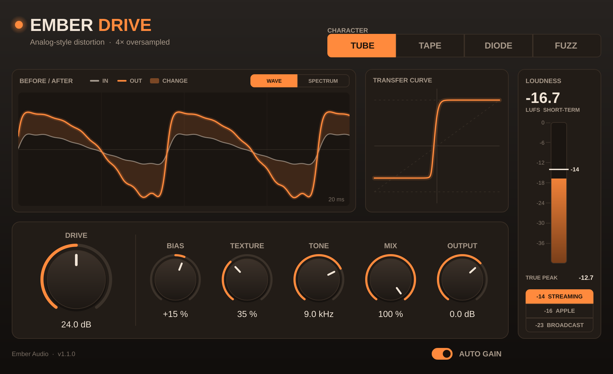
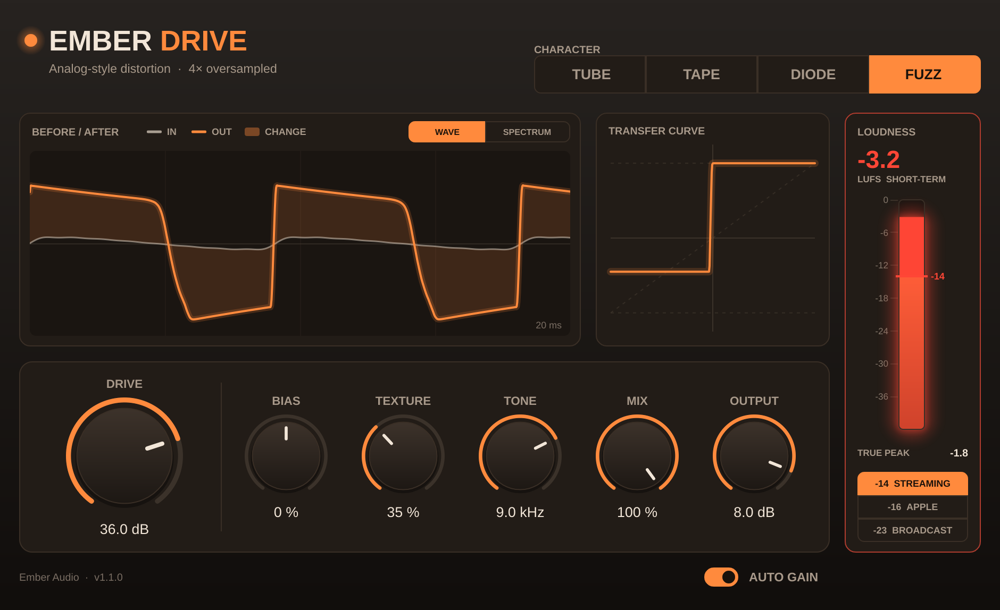

# Ember Drive

An analog-style distortion plug-in (VST3, plus AU on macOS) built with [JUCE](https://juce.com).



## Controls

| Control | What it does |
|---|---|
| **Character** | The circuit being modelled. **Tube**: asymmetric soft clip, warm (even + odd harmonics). **Tape**: very soft, smooth compression. **Diode**: firmer knee, overdrive-pedal crunch. **Fuzz**: hard, lopsided transistor clip. |
| **Drive** | 0–48 dB of gain into the clipper. |
| **Bias** | Shifts the clipper's operating point off-centre. Turn it away from 0 for more even harmonics (that "warm/thick" sound) and a sputtery, starved feel at extremes. |
| **Texture** | Subtle analog life (default 35%, 0% = clean and static). See below. |
| **Tone** | Low-pass after the clipper (800 Hz – 20 kHz) to tame fizz. |
| **Mix** | Parallel blend with the clean signal (dry is latency-matched, so no phasing). |
| **Output** | Final level, −24 to +12 dB. |
| **Auto Gain** | Compensates loudness as you raise Drive, so you hear tone changes rather than just "louder". |

Double-click any knob to reset it. Hover over a control for a short explanation.

## Texture

Three small behaviours of real circuits, layered on the clipper:

- **Sag**: loud hits pull the operating point and the gain down slightly, like a tube stage's bias shifting and its power supply sagging. Even harmonics bloom on the attack and relax as the note decays.
- **Drift**: each channel's drive and bias wander very slowly, like components that are never quite identical. You get gentle movement, plus a little stereo width even from a mono source.
- **Grain**: fine noise that rides on the signal and is fed into the clipper, so it turns into grit instead of sitting on top as hiss. It disappears completely in silence.

Measured at the default 35%: the grain sits about 57 dB below the signal on a clean setting and 51 dB below on heavy fuzz. The sag puts 2nd harmonic at −34 dB into the otherwise symmetric Tape mode, and left and right differ by about −35 dB.

The random parts are re-seeded every time playback starts, so an offline bounce sounds exactly like what you heard.

## Displays

- **Before / After**: the plug-in's input and output overlaid. Use **Wave** to see how the distortion reshapes the waveform (the shaded area is what changed). Use **Spectrum** to see the harmonics it adds (the shaded area is where the output rises above the input). The input is delayed to line up with the output exactly.
- **Transfer curve**: the clipper's shape for the current Character, Drive and Bias.
- **Loudness**: short-term loudness (3 s window, ITU-R BS.1770 / EBU R128) of the plug-in's output, plus the true peak (4x oversampled). Pick a target below the bar:

  | Target | Where it comes from |
  |---|---|
  | −14 LUFS | Spotify's normalization level, the usual streaming reference |
  | −16 LUFS | The level Apple Music is commonly measured to play at |
  | −23 LUFS | EBU R128 broadcast standard |

  **The bar glows red when the short-term loudness is above the target, or when the true peak goes over −1 dBTP** (the ceiling both EBU R128 and Spotify recommend).

  Streaming services measure a whole song (integrated loudness), so a loud chorus briefly going red is normal. A bar that stays red means the track is louder than the platform plays it, and the platform will turn it down.



## Getting the .vst3

This folder is the plug-in's source code. It has to be compiled ("built") once to become the `.vst3` file your music software loads. There are two free ways to do that.

### Option 1: let GitHub build it (nothing to install)

1. Make a free account at [github.com](https://github.com) and sign in.
2. Click **+** (top right) → **New repository**, name it `EmberDrive`, and click **Create repository**.
3. On the page that opens, click **uploading an existing file**.
4. Open this `EmberDrive` folder, select everything **inside** it (Ctrl+A on Windows, Cmd+A on Mac) and drag it onto the upload page. Drag the contents, not the folder itself. Click **Commit changes**.
5. Click the **Actions** tab. A build starts by itself and takes about 10–15 minutes.
   - If the page says *Get started with GitHub Actions* instead, the `.github` folder didn't upload. Click **set up a workflow yourself**, replace the text with the contents of `.github/workflows/build.yml` from this folder, and click **Commit changes**.
6. When the build shows a green tick, click it. Under **Artifacts**, download **EmberDrive-Windows** (or **EmberDrive-macOS**).
7. Unzip it and follow the `How to install` note inside.

### Option 2: build it on your own computer

**Windows**

1. Install **Visual Studio Community** (free) from [visualstudio.microsoft.com](https://visualstudio.microsoft.com/). In the installer, tick **Desktop development with C++** and click Install. It's a large download, several GB.
2. Unzip this project to a short path, e.g. right-click the zip → **Extract All** → type `C:\` → **Extract**. That gives you `C:\EmberDrive`.
3. Open the Start menu, type **Developer PowerShell**, open it, and paste these three lines:

   ```
   cd C:\EmberDrive
   cmake --preset windows-release
   cmake --build --preset windows-release
   ```

   The first run downloads JUCE (the framework the plug-in is built on) and takes 5–15 minutes.
4. Your plug-in is `C:\EmberDrive\out\windows-release\EmberDrive_artefacts\Release\VST3\Ember Drive.vst3`. Copy that folder to `C:\Program Files\Common Files\VST3\` and rescan plug-ins in your music software.

**Mac**: install Xcode from the App Store, open Terminal in this folder, and run `cmake --preset release` then `cmake --build --preset release` (CMake comes from [cmake.org](https://cmake.org/download/) or Homebrew). The plug-ins land in `out/release/EmberDrive_artefacts/Release/`. Then follow `packaging/How to install (macOS).txt`.

**Linux**: `sudo apt install build-essential cmake libfreetype-dev libfontconfig1-dev libx11-dev libxcomposite-dev libxcursor-dev libxext-dev libxinerama-dev libxrandr-dev libxrender-dev`, then the same two `cmake --preset release` commands, and copy the `.vst3` to `~/.vst3/`.

**Notes for developers**

- Any CMake 3.22+ workflow works too: `cmake -B build -DCMAKE_BUILD_TYPE=Release` and `cmake --build build --config Release`. The plug-in then lands in `build/EmberDrive_artefacts/Release/`.
- JUCE 8.0.15 is downloaded as a source archive, so Git isn't needed. To use a JUCE copy you already have, add `-DFETCHCONTENT_SOURCE_DIR_JUCE=/path/to/JUCE`.
- On Windows the C++ runtime is linked statically, so the plug-in doesn't need the Visual C++ Redistributable.
- `-DEMBER_COPY_AFTER_BUILD=ON` copies the plug-in into the system plug-in folder after each build (on Windows this needs an administrator terminal).

## How it works

```
in ──┬──────────────────────────────────────────────────── (delayed to match) ──┐
     │                                                                           ├─ Mix ─> out ─> meters
     └─> 4x upsample ─> + grain ─> Drive (sag, drift) ─> + Bias ─> clipper curve │
             ─> 4x downsample ─> DC blocker ─> Tone low-pass ─> Output/Auto Gain ┘
```

- **Oversampling (4x, polyphase IIR)**: clipping creates harmonics far above the audio band; running the clipper at 4x the sample rate stops them folding back down as harsh, inharmonic aliasing. In testing, a 7 kHz tone through the Fuzz mode had about 18 dB less aliasing than the same curve without oversampling.
- **Bias** is scaled with the square root of the drive, so the asymmetry (and its even harmonics) doesn't disappear at high gain the way it does with a fixed offset. Tube and Fuzz also have a small built-in bias, like the real circuits.
- **DC blocker** (10 Hz high-pass) removes the offset that asymmetric clipping produces.
- All knobs are smoothed over 50 ms so automation and knob moves don't click.
- Latency is 6 samples at 48 kHz and is reported to the host for automatic compensation.
- The displays read the audio through lock-free buffers, so the audio thread never waits for the screen.

## Source files

| File | What's in it |
|---|---|
| `Source/DistortionEngine.h` | The four clipping curves, bias and auto-gain maths |
| `Source/AnalogTexture.h` | Sag, drift and grain |
| `Source/Metering.h` | Loudness (LUFS) and true-peak meter, plus the buffers the displays read |
| `Source/PluginProcessor.*` | Parameters and the audio processing chain |
| `Source/Displays.*` | Transfer curve, Before/After view, loudness bar |
| `Source/Controls.*`, `Source/EmberLookAndFeel.h` | Knobs, buttons and the visual style |
| `Source/PluginEditor.*` | Window layout |

## Tweaking the sound

- **Clipping curves**: `Source/DistortionEngine.h`. Each mode is a small function; edit or add your own. The transfer-curve display in the UI uses the same code, so it updates automatically.
- **Texture amounts**: the depth constants at the top of `Source/AnalogTexture.h`.
- **Oversampling factor**: `oversamplingOrder` in `Source/PluginProcessor.h` (1 = 2x, 2 = 4x, 3 = 8x).
- **Loudness targets**: the `targets` list in `Source/Displays.cpp`.
- **Name / company / plug-in IDs**: `juce_add_plugin(...)` in `CMakeLists.txt`. Change `PLUGIN_MANUFACTURER_CODE` and `PLUGIN_CODE` to your own 4-letter codes before sharing it.

## Testing

- The Linux builds (GCC and Clang, JUCE 8.0.15) pass [pluginval](https://github.com/Tracktion/pluginval) at its strictest level (10), including the editor tests. Our own source files compile with zero warnings under Clang's strict set (conversion, shadowing, sign and float-comparison checks).
- The Windows and Mac builds come from the GitHub workflow and haven't been run through these tests yet.
- **Loudness meter**: a stereo 1 kHz sine at −23 and −33 dBFS reads within 0.01 LU of the EBU Tech 3341 reference at 44.1, 48 and 96 kHz (the spec allows ±0.1). The weighting filter matches the one published in BS.1770 to within 0.001 dB from 30 Hz to 16 kHz. A full-scale 12 kHz tone whose samples only reach −3 dBFS reads +0.09 dBTP true peak (correct: 0).
- **Texture**: with Texture at 0% the output is identical to version 1.0. Silence in gives exact silence out at every setting, and two renders of the same audio are bit-identical.

## Licensing

JUCE has its own licence terms: it is free for personal and open-source projects; check [juce.com](https://juce.com/get-juce/) before selling a closed-source plug-in. The VST3 SDK that JUCE 8.0.15 includes is MIT-licensed.
